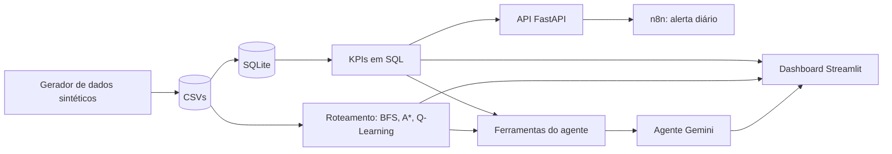
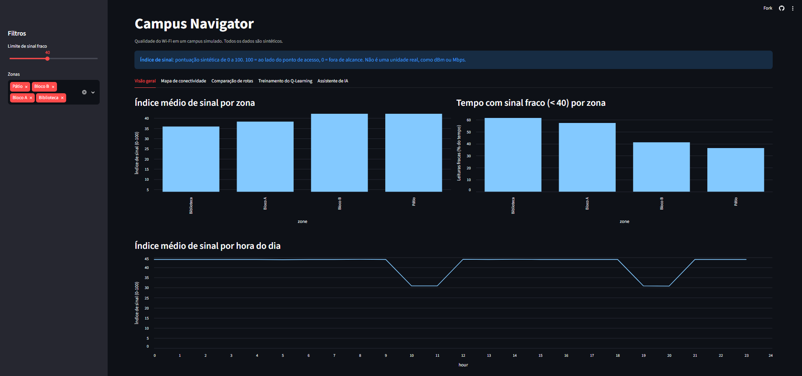
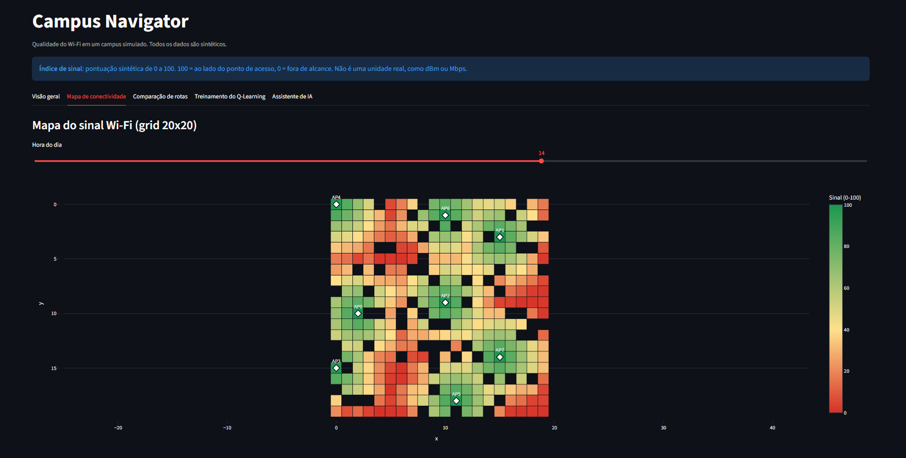
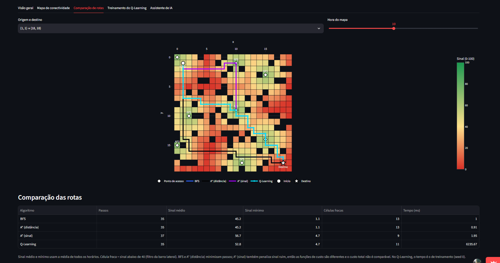
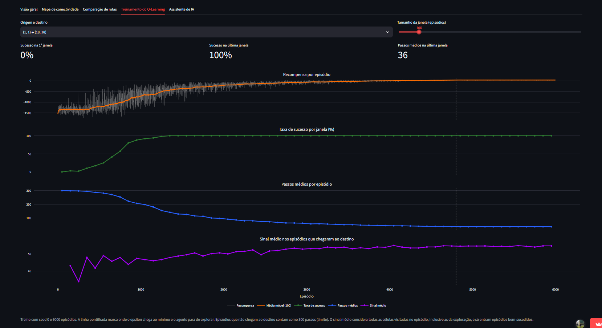
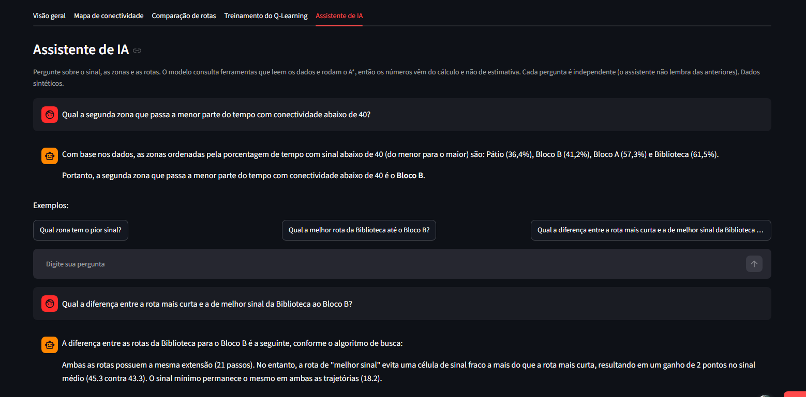

# Campus Navigator

Portfólio de desenvolvimento de agentes de IA: roteamento com consciência de
conectividade Wi-Fi em um mapa de campus simulado, com dashboard, agente de
LLM com ferramentas e roteador com Q-Learning. O projeto nasceu do meu TCC,
sobre Reinforcement Learning para roteamento em campus levando em conta a
qualidade do Wi-Fi.

**Demo online:** <https://campus-navigator-bccc.streamlit.app/>

> Todos os dados são **sintéticos**. O modelo de sinal é uma simplificação
> inventada, não uma medição real. O índice de sinal vai de 0 a 100 e não é
> uma unidade real (como dBm ou Mbps).

## O que o projeto faz

- Gera um campus simulado (grid 20x20 com paredes, pontos de acesso Wi-Fi e
  zonas) e leituras horárias de sinal.
- Calcula KPIs em SQL (sinal médio por zona, % de leituras fracas, sinal por
  hora).
- Compara BFS, A* e Q-Learning para rotas com boa conectividade.
- Responde perguntas em linguagem natural com um agente Gemini que usa
  ferramentas (SQL e algoritmos de rota), sem inventar números.
- Expõe uma API FastAPI e um workflow n8n com alerta diário.
- Mostra tudo em um dashboard Streamlit com 5 abas.

## Arquitetura



## Modelo de conectividade

O índice de sinal (0 a 100) de cada célula combina:

- **Distância** até o ponto de acesso mais próximo (alcance de 6 células).
- **Paredes**: penalidade de 12 pontos por parede interceptada entre o ponto
  de acesso e a célula, estimada por amostragem ao longo da linha.
- **Horário de pico**, que reduz o sinal.
- **Ruído gaussiano.**

Nos dados atuais, o sinal médio cai de cerca de 44 fora do pico para cerca de
31 no pico. Sinal abaixo de 40 é considerado fraco.

| Zona | Sinal médio | Leituras fracas |
|---|---|---|
| Pátio | 47,4 | 36,4% |
| Bloco B | 45,3 | 41,2% |
| Bloco A | 38,3 | 57,3% |
| Biblioteca | 35,9 | 61,5% |

## Dashboard

O dashboard (Streamlit + Plotly) tem 5 abas:

1. **Visão geral:** sinal médio por zona, tempo com sinal fraco e sinal por
   hora, com filtros de zona e de limite de sinal fraco.
2. **Mapa de conectividade:** mapa de calor do grid por horário, com paredes
   e pontos de acesso.
3. **Comparação de rotas:** BFS, A* (distância), A* (sinal) e Q-Learning no
   mapa, com tabela de métricas calculadas na hora.
4. **Treinamento do Q-Learning:** recompensa por episódio com média móvel,
   taxa de sucesso, passos médios e sinal médio durante o treino.
5. **Assistente de IA:** chat com o agente Gemini.







## Roteamento (BFS, A* e Q-Learning)

Mesmo ambiente (grid 20x20 com sinal médio por célula), comparando BFS (custo
uniforme), A* por distância, A* com custo de sinal e um agente Q-Learning
tabular. Resultados em `results/route_comparison.csv` (3 pares
origem/destino, 5 seeds para o Q-Learning).

| Par | Algoritmo | Passos | Sinal médio | Sinal mín. | Células fracas |
|---|---|---|---|---|---|
| (0,15)→(19,0) | BFS / A* distância | 37 | 48,7 | 1,2 | 13 |
| | A* sinal / Q-Learning | 37 | 60,2 | 15,7 | 7 |
| (1,1)→(18,18) | BFS / A* distância | 35 | 45,2 | 1,1 | 13 |
| | A* sinal | 37 | 56,7 | 4,7 | 9 |
| | Q-Learning | 35 | 52,8 | 4,7 | 11 |
| (2,16)→(18,1) | BFS / A* distância | 32 | 47,2 | 1,2 | 11 |
| | A* sinal / Q-Learning | 32 | 60,6 | 29,8 | 5 |

**Observações**
- O A* com sinal otimiza um custo diferente de BFS e A* por distância, então a
  comparação não é direta.
- O tempo do Q-Learning (~4 s) é de treino, feito uma vez; as buscas levam
  milissegundos.
- A primeira versão do agente não convergiu (recompensa esparsa) e foi
  corrigida com reward shaping por distância.

### Curva de aprendizado

No treino do par (1,1)→(18,18) (seed 0, 6000 episódios), a taxa de sucesso vai
de 0% na primeira janela a 100% na última, os passos médios caem de 300 (o
limite) para cerca de 36 e a recompensa sobe de aproximadamente -1.400 para
perto de 0. O sinal médio das rotas encontradas melhora de forma modesta
(de cerca de 47 para cerca de 52).


## Agente de LLM

Gemini com tool calling. O modelo interpreta a pergunta e escolhe as
ferramentas, mas os números vêm de consultas SQL e dos algoritmos de rota.

Ferramentas: pior e melhor zona, % de sinal fraco por zona, sinal por hora,
horas mais fracas, rota entre zonas (`get_route`) e comparação entre a rota
mais curta e a de melhor sinal (`compare_routes`).

Exemplo: "Qual a diferença entre a rota mais curta e a de melhor sinal da
Biblioteca ao Bloco B?" retorna, do cálculo, 21 passos nas duas, sinal médio
43,3 contra 45,3 e 11 contra 10 células fracas.

O script `evaluate` roda 10 perguntas (dentro do escopo, fora do escopo e
entrada inválida) e obtém 10/10 nos dados atuais. A avaliação é por palavra-chave
e ainda não cobre as ferramentas de rota; ampliar os casos e usar verificações
determinísticas é o próximo passo.

## Automação (n8n)

Um workflow no n8n (`automation/daily_report.json`) chama o endpoint `/report`
da API todos os dias às 8h e, se alguma zona passa de 45% de leituras com sinal
fraco, monta a mensagem de alerta. Para usar: suba a API, rode `npx n8n` e
importe o arquivo.

## Instalação

```
python -m venv .venv
.venv\Scripts\Activate.ps1
pip install -r requirements.txt
```

Para o agente e o chat é preciso uma chave da API do Gemini na variável
`GEMINI_API_KEY`, em um arquivo `.env` na raiz do projeto (não versionado):

    GEMINI_API_KEY=sua-chave-aqui

Na demo online, a chave fica nos Secrets do Streamlit.

## Como rodar

```
python -m src.data_gen.generate
python -m pytest
python -m src.kpis.db
python -m src.kpis.queries
python -m streamlit run dashboard/app.py
python -m src.agent.agent
python -m src.agent.evaluate
python -m uvicorn src.api:app --port 8000
python -m src.router.compare
```

## Limitações conhecidas

- Dados sintéticos e modelo de sinal simplificado, sem validação com medições
  reais.
- As rotas usam o sinal médio de todos os horários; o seletor de hora do mapa
  muda só a cor de fundo.
- O Q-Learning é tabular, treinado para um par origem/destino por vez, e foi
  comparado em apenas 3 pares.
- No agente, origem e destino de uma rota são a célula caminhável mais central
  de cada zona, e as rotas usam A*.
- O chat não tem memória entre perguntas e tem limite de 10 perguntas por
  sessão na demo, por causa da cota gratuita da API.
- A avaliação do agente é por palavra-chave e cobre poucos casos.

## Roadmap

- [x] Dia 1: gerador de dados sintéticos
- [x] Dia 2: banco SQLite e KPIs em SQL
- [x] Dia 3: dashboard Streamlit publicado
- [x] Dia 4: agente de LLM com tool calling e avaliação
- [x] Dia 5: API FastAPI e automação n8n
- [x] Dia 6: sinal com paredes, ambiente em grid, BFS e A*
- [x] Dia 7: Q-Learning e comparação quantitativa
- [x] Dia 8: mapa de calor, comparação de rotas e curva de aprendizado do Q-Learning no dashboard
- [x] Dia 9: agente com ferramentas de rota e chat no Streamlit

Próximos passos

- [ ] Avaliação ampliada do agente (mais casos, perguntas de rota e fora do escopo)
- [ ] Testes da API e das ferramentas de rota
- [ ] Alerta do n8n por e-mail ou Telegram